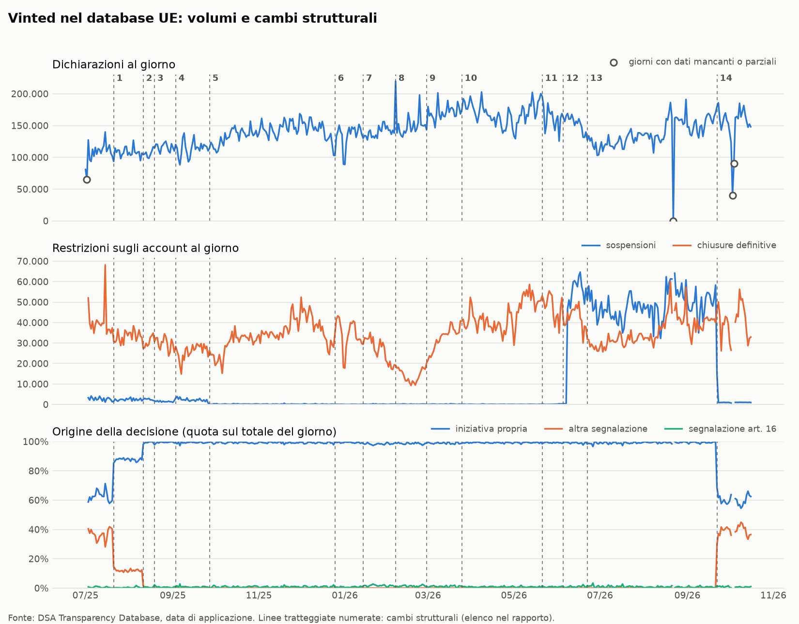
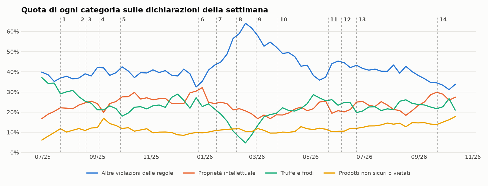

# Qualità e stabilità dei dati Vinted nel DSA Transparency Database

Generato il 2026-10-22. Modalità cieca: ATTIVA, dati fino al 2026-10-16 compreso. Dati caricati il 2026-10-22T11:32:35.

## Le domande di fattibilità

| Domanda | Risposta | Esito |
| --- | --- | --- |
| Quante dichiarazioni ci sono? | 66.713.658 in 473 giorni, mediana 140.595 al giorno; 4 giorni con dati mancanti o parziali | OK |
| Le righe caricate corrispondono a quelle del sito? | 66.713.658 contro 66.621.104 dichiarate, 0 giorni oltre l'1% da verificare, 4 già verificati | OK |
| Quanto spesso cambia il modo di segnalare? | 14 cambi strutturali in 473 giorni (ultimo: 2026-09-22) | Da tenere in conto |
| Quanto varia normalmente il totale in 14 giorni? | tra -13% e +14% nel 90% dei casi (lontano dai cambi strutturali) | OK |
| Quale finestra di base usare? | 2026-09-23 - 2026-10-16, 22 giorni validi | OK |
| I campi distinguono annunci/account, automazione, origine? | restrizioni account nel 32.6% delle dichiarazioni; decisione automatica vuota nel 0% | OK |
| Le motivazioni distinguono i casi? | 100% delle dichiarazioni in 5 testi fissi; merce rubata citata in 0 dichiarazioni | Problema |

## Da guardare per primo

- La compilazione cambia nel tempo per: decision_account. Confronti prima/dopo su questi campi vanno trattati con cautela.
- Estensione vuota o pari a tutta l'UE in oltre il 90% dei casi: nessun confronto Francia-Italia possibile con questi dati.
- Motivazioni standard (100% delle dichiarazioni in 5 testi fissi): non distinguono merce rubata, contraffazione o vendita commerciale. È un dato rilevante per la trasparenza richiesta dall'art. 17 del DSA. Si analizza la composizione per categoria.

## 1. Copertura

Si contano **dichiarazioni di motivazione**, non account né persone: uno stesso account può ricevere più dichiarazioni.

| Misura | Valore |
| --- | --- |
| Dichiarazioni | 66.713.658 |
| Primo giorno (applicazione) | 2025-07-01 |
| Ultimo giorno (applicazione) | 2026-10-16 |
| Ultimo giorno di invio all'UE | 2026-10-16 |
| Giorni nel periodo | 473 |
| Giorni senza alcuna dichiarazione | 0 |
| Giorni con dati mancanti o parziali (sotto metà dei giorni vicini) | 4 |
| Dichiarazioni al giorno (mediana) | 140.595 |
| Righe con identificativo (uuid) ripetuto | 168 |

Giorni con dati mancanti o parziali (vanno esclusi da ogni stima):

| Giorno | Dichiarazioni | Mediana dei giorni vicini |
| --- | --- | --- |
| 2025-07-02 | 65.385 | 110.598 |
| 2026-08-22 | 5 | 148.007 |
| 2026-10-03 | 40.113 | 160.118 |
| 2026-10-04 | 90.343 | 160.835 |

Le 168 righe ripetute sono lo 0.0003% del totale: trascurabili per i conteggi, ma vanno tolte nell'analisi finale.

Mese per mese:

| Mese | Dichiarazioni | Mediana al giorno | Giorni |
| --- | --- | --- | --- |
| 2025-07 | 3.338.532 | 109.046 | 31 |
| 2025-08 | 3.432.574 | 108.195 | 31 |
| 2025-09 | 3.427.790 | 114.864 | 30 |
| 2025-10 | 4.147.328 | 134.539 | 31 |
| 2025-11 | 4.378.184 | 144.759 | 30 |
| 2025-12 | 4.331.184 | 142.472 | 31 |
| 2026-01 | 4.287.093 | 139.514 | 31 |
| 2026-02 | 4.195.652 | 143.727 | 28 |
| 2026-03 | 5.396.870 | 172.242 | 31 |
| 2026-04 | 4.936.123 | 165.159 | 30 |
| 2026-05 | 5.223.923 | 167.957 | 31 |
| 2026-06 | 4.327.412 | 151.810 | 30 |
| 2026-07 | 3.896.900 | 124.318 | 31 |
| 2026-08 | 4.393.915 | 137.759 | 31 |
| 2026-09 | 4.646.035 | 154.373 | 30 |
| 2026-10 | 2.354.143 | 158.716 | 16 |

## 1b. Controllo del caricamento

Per ogni giorno il sito dichiara quante dichiarazioni contiene il file. Qui si confronta con le righe finite nel database. Una differenza grande vuol dire righe perse o lette male. Il file di un giorno può contenere anche qualche decisione di giorni precedenti: il confronto si fa per file, non per data di applicazione.

| Misura | Valore |
| --- | --- |
| Giorni confrontati | 472 |
| Dichiarate dal sito | 66.621.104 |
| Caricate nel database | 66.713.658 |
| Differenza (%) | 0.1 |
| Giorni con differenza oltre l'1% (non ancora verificati) | 0 |
| Giorni con differenza oltre l'1% (verificati: è il sito a non tornare) | 4 |

Giorni in cui il sito dichiara un numero diverso dal contenuto del suo stesso file (verificato contando le righe direttamente nello ZIP: il caricamento è corretto):

| Giorno | Sito | Caricate | Differenza | Vicini |
| --- | --- | --- | --- | --- |
| 2026-05-08 | 69.569 | 175.942 | 106.373 | 167.090 |
| 2026-09-30 | 159.738 | 153.633 | -6.105 | 162.458 |
| 2026-10-01 | 135.191 | 138.851 | 3.660 | 160.835 |
| 2026-10-02 | 135.346 | 123.809 | -11.537 | 159.401 |

## 2. Ritardo tra decisione e invio all'UE

Si misura sulle decisioni applicate almeno 30 giorni prima dell'ultimo invio.

| Misura | Valore |
| --- | --- |
| Dichiarazioni usate per la misura | 62.080.268 |
| Ritardo mediano (giorni) | 0 |
| 90% inviate entro (giorni) | 0 |
| 99% inviate entro (giorni) | 0 |
| Ritardo massimo osservato (giorni) | 1 |
| Quota inviata dopo più di 7 giorni (%) | 0.0 |
| Dichiarazioni con invio prima della decisione (errori di data) | 564.333 |

Per l'analisi della finestra dell'evento servono file scaricati fino ad almeno 1 giorni dopo la fine della finestra.

## 3. Cambi strutturali nel modo di segnalare

Per ogni giorno si confronta la media dei 14 giorni validi precedenti con quella dei 14 giorni validi da quel giorno in poi (i giorni con dati mancanti sono esclusi). Si segnala un cambio quando un volume cresce o cala di oltre 1.5 volte, o una quota si sposta di oltre 10 punti percentuali. I cambi vicini (entro 7 giorni) formano un solo evento. Un cambio strutturale è un cambio nel modo in cui Vinted compila i dati, oppure un cambio reale nella moderazione: questi dati da soli non distinguono le due cose.

| N. | Inizio | Metriche coinvolte | Media prima → dopo |
| --- | --- | --- | --- |
| 1 | 2025-07-21 | 2 | Quota da iniziativa propria (%): 63.3 → 87.7; Quota da altra segnalazione (%): 36.1 → 12.1 |
| 2 | 2025-08-11 | 2 | Quota da iniziativa propria (%): 87.6 → 99.2; Quota da altra segnalazione (%): 11.9 → 0.1 |
| 3 | 2025-08-19 | 1 | Sospensioni di account: 2.417 → 1.434 |
| 4 | 2025-09-03 | 1 | Sospensioni di account: 1.441 → 2.512 |
| 5 | 2025-09-27 | 1 | Sospensioni di account: 1.961 → 159 |
| 6 | 2025-12-25 | 1 | Sospensioni di account: 142 → 58 |
| 7 | 2026-01-14 | 1 | Sospensioni di account: 53 → 129 |
| 8 | 2026-02-06 | 2 | Quota Altre violazioni delle regole (%): 49.0 → 60.0; Chiusure definitive di account: 22.055 → 12.410 |
| 9 | 2026-02-28 | 1 | Chiusure definitive di account: 13.110 → 28.345 |
| 10 | 2026-03-25 | 1 | Sospensioni di account: 140 → 70 |
| 11 | 2026-05-21 | 1 | Sospensioni di account: 61 → 128 |
| 12 | 2026-06-05 | 2 | Sospensioni di account: 132 → 44.439; Quota con restrizione sull'account (%): 28.2 → 64.8 |
| 13 | 2026-06-22 | 1 | Chiusure definitive di account: 43.114 → 28.307 |
| 14 | 2026-09-22 | 4 | Quota con restrizione sull'account (%): 57.8 → 25.9; Quota da iniziativa propria (%): 99.2 → 60.3; Quota da altra segnalazione (%): 0.0 → 38.8; Sospensioni di account: 46.873 → 963 |

Eventi trovati: **14** in 473 giorni (circa 10.8 all'anno). Ogni confronto prima/dopo l'evento del 17 ottobre deve tenere conto di questa frequenza: un cambio di quella misura capita anche senza eventi esterni.

## 4. Quanto varia normalmente la serie in 14 giorni

Nota: questa sezione serve a descrivere la serie. Le soglie usate per le ipotesi registrate sono calcolate con la geometria della preregistrazione (finestra di 15 giorni, base registrata) in `reports/placebo.md`, e possono differire un poco da quelle qui sotto.

Per ogni giorno valido si confronta la media dei 14 giorni successivi con quella dei 14 precedenti. La distribuzione di queste variazioni, su tutto lo storico, è il termine di paragone (placebo) per la finestra dopo il 17 ottobre: la variazione osservata dopo l'evento si colloca in questa distribuzione. Si mostrano due versioni: tutti i giorni, e solo i giorni lontani dai cambi strutturali.

| Metrica | Giorni | Confronti | 5° percentile | Mediana | 95° percentile |
| --- | --- | --- | --- | --- | --- |
| Dichiarazioni al giorno | tutti | 442 | -13% | +2% | +14% |
| Dichiarazioni al giorno | lontani dai cambi | 442 | -13% | +2% | +14% |
| Sospensioni di account | tutti | 442 | -79% | -6% | +132% |
| Sospensioni di account | lontani dai cambi | 238 | -23% | -3% | +21% |
| Chiusure definitive di account | tutti | 442 | -31% | -0% | +40% |
| Chiusure definitive di account | lontani dai cambi | 369 | -20% | +0% | +31% |
| Quota con restrizione sull'account (%) | tutti | 442 | -8.7 pt | -0.5 pt | +8.7 pt |
| Quota con restrizione sull'account (%) | lontani dai cambi | 392 | -6.4 pt | -0.5 pt | +5.1 pt |
| Quota Altre violazioni delle regole (%) | tutti | 442 | -5.6 pt | -0.7 pt | +8.4 pt |
| Quota Altre violazioni delle regole (%) | lontani dai cambi | 415 | -5.7 pt | -1.0 pt | +5.4 pt |
| Quota Proprietà intellettuale (%) | tutti | 442 | -3.7 pt | +0.2 pt | +4.7 pt |
| Quota Proprietà intellettuale (%) | lontani dai cambi | 442 | -3.7 pt | +0.2 pt | +4.7 pt |
| Quota Truffe e frodi (%) | tutti | 442 | -6.1 pt | -0.4 pt | +5.2 pt |
| Quota Truffe e frodi (%) | lontani dai cambi | 442 | -6.1 pt | -0.4 pt | +5.2 pt |
| Quota Prodotti non sicuri o vietati (%) | tutti | 442 | -1.7 pt | +0.3 pt | +2.1 pt |
| Quota Prodotti non sicuri o vietati (%) | lontani dai cambi | 442 | -1.7 pt | +0.3 pt | +2.1 pt |

Effetto del giorno della settimana (dichiarazioni rispetto alla media della settimana):

| Giorno | Scarto |
| --- | --- |
| lunedì | +3% |
| martedì | +2% |
| mercoledì | +1% |
| giovedì | +0% |
| venerdì | -3% |
| sabato | -6% |
| domenica | +3% |

## 5. Finestra di base prima dell'evento

Finestra registrata (config `base_da`): dal **2026-09-23** al **2026-10-16**, esclusi i giorni con dati mancanti o parziali: **22 giorni validi**. Il rilevatore automatico colloca l'ultimo cambio strutturale al 2026-09-22; quel giorno è di transizione (il cambio avviene durante la giornata), per questo la base parte dal giorno dopo.
Una finestra che attraversa un cambio strutturale mescolerebbe due modi diversi di segnalare e falserebbe il confronto.

## 6. Campi vuoti

Alcuni campi sono vuoti per costruzione (per esempio la decisione sull'account quando la dichiarazione riguarda solo un annuncio).

| Campo | Vuoto (%) |
| --- | --- |
| uuid | 0.0 |
| puid | 100.0 |
| platform_name | 0.0 |
| application_date | 0.0 |
| content_date | 0.0 |
| created_at | 0.0 |
| decision_visibility | 0.1 |
| decision_monetary | 100.0 |
| decision_provision | 100.0 |
| decision_account | 67.4 |
| account_type | 100.0 |
| decision_ground | 0.0 |
| category | 0.0 |
| category_specification | 100.0 |
| content_type | 0.0 |
| automated_detection | 0.0 |
| automated_decision | 0.0 |
| source_type | 0.0 |
| territorial_scope | 0.0 |
| content_language | 100.0 |
| decision_facts | 0.0 |
| incompatible_content_ground | 0.0 |
| incompatible_content_explanation | 0.0 |
| illegal_content_legal_ground | 100.0 |
| illegal_content_explanation | 100.0 |
| end_date_account_restriction | 91.8 |
| end_date_visibility_restriction | 100.0 |
| file_giorno | 0.0 |

Campi chiave vuoti, mese per mese (%). Un salto improvviso indica un cambio nel modo di compilare:

| Mese | Dichiarazioni | automated_detection | automated_decision | source_type | territorial_scope | decision_facts | category | decision_account |
| --- | --- | --- | --- | --- | --- | --- | --- | --- |
| 2025-07 | 3.338.532 | 0.0 | 0.0 | 0.0 | 0.0 | 0.0 | 0.0 | 63.9 |
| 2025-08 | 3.432.574 | 0.0 | 0.0 | 0.0 | 0.0 | 0.0 | 0.0 | 69.6 |
| 2025-09 | 3.427.790 | 0.0 | 0.0 | 0.0 | 0.0 | 0.0 | 0.0 | 75.7 |
| 2025-10 | 4.147.328 | 0.0 | 0.0 | 0.0 | 0.0 | 0.0 | 0.0 | 77.8 |
| 2025-11 | 4.378.184 | 0.0 | 0.0 | 0.0 | 0.0 | 0.0 | 0.0 | 74.9 |
| 2025-12 | 4.331.184 | 0.0 | 0.0 | 0.0 | 0.0 | 0.0 | 0.0 | 73.0 |
| 2026-01 | 4.287.093 | 0.0 | 0.0 | 0.0 | 0.0 | 0.0 | 0.0 | 77.7 |
| 2026-02 | 4.195.652 | 0.0 | 0.0 | 0.0 | 0.0 | 0.0 | 0.0 | 89.8 |
| 2026-03 | 5.396.870 | 0.0 | 0.0 | 0.0 | 0.0 | 0.0 | 0.0 | 80.1 |
| 2026-04 | 4.936.123 | 0.0 | 0.0 | 0.0 | 0.0 | 0.0 | 0.0 | 75.7 |
| 2026-05 | 5.223.923 | 0.0 | 0.0 | 0.0 | 0.0 | 0.0 | 0.0 | 70.8 |
| 2026-06 | 4.327.412 | 0.0 | 0.0 | 0.0 | 0.0 | 0.0 | 0.0 | 45.0 |
| 2026-07 | 3.896.900 | 0.0 | 0.0 | 0.0 | 0.0 | 0.0 | 0.0 | 38.7 |
| 2026-08 | 4.393.915 | 0.0 | 0.0 | 0.0 | 0.0 | 0.0 | 0.0 | 38.7 |
| 2026-09 | 4.646.035 | 0.0 | 0.0 | 0.0 | 0.0 | 0.0 | 0.0 | 51.9 |
| 2026-10 | 2.354.143 | 0.0 | 0.0 | 0.0 | 0.0 | 0.0 | 0.0 | 74.3 |

## 7. Come Vinted compila i campi

### category

| Valore | Dichiarazioni | Quota (%) |
| --- | --- | --- |
| STATEMENT_CATEGORY_OTHER_VIOLATION_TC | 28.312.508 | 42.4 |
| STATEMENT_CATEGORY_INTELLECTUAL_PROPERTY_INFRINGEMENTS | 15.590.543 | 23.4 |
| STATEMENT_CATEGORY_SCAMS_AND_FRAUD | 14.969.975 | 22.4 |
| STATEMENT_CATEGORY_UNSAFE_AND_PROHIBITED_PRODUCTS | 7.813.047 | 11.7 |
| STATEMENT_CATEGORY_ILLEGAL_OR_HARMFUL_SPEECH | 27.585 | 0.0 |

### decision_ground

| Valore | Dichiarazioni | Quota (%) |
| --- | --- | --- |
| DECISION_GROUND_INCOMPATIBLE_CONTENT | 66.713.658 | 100.0 |

### decision_account

| Valore | Dichiarazioni | Quota (%) |
| --- | --- | --- |
| (vuoto) | 44.956.948 | 67.4 |
| DECISION_ACCOUNT_TERMINATED | 16.311.462 | 24.4 |
| DECISION_ACCOUNT_SUSPENDED | 5.445.248 | 8.2 |

### decision_provision

| Valore | Dichiarazioni | Quota (%) |
| --- | --- | --- |
| (vuoto) | 66.713.658 | 100.0 |

### decision_monetary

| Valore | Dichiarazioni | Quota (%) |
| --- | --- | --- |
| (vuoto) | 66.713.658 | 100.0 |

### account_type

| Valore | Dichiarazioni | Quota (%) |
| --- | --- | --- |
| (vuoto) | 66.713.658 | 100.0 |

### automated_detection

| Valore | Dichiarazioni | Quota (%) |
| --- | --- | --- |
| True | 36.308.711 | 54.4 |
| False | 30.404.947 | 45.6 |

### automated_decision

| Valore | Dichiarazioni | Quota (%) |
| --- | --- | --- |
| AUTOMATED_DECISION_NOT_AUTOMATED | 44.130.739 | 66.1 |
| AUTOMATED_DECISION_FULLY | 22.582.919 | 33.9 |

### source_type

| Valore | Dichiarazioni | Quota (%) |
| --- | --- | --- |
| SOURCE_VOLUNTARY | 63.597.426 | 95.3 |
| SOURCE_TYPE_OTHER_NOTIFICATION | 2.544.451 | 3.8 |
| SOURCE_ARTICLE_16 | 571.781 | 0.9 |

### decision_visibility (una dichiarazione può avere più valori)

| Valore | Dichiarazioni | Quota sul totale (%) |
| --- | --- | --- |
| DECISION_VISIBILITY_CONTENT_REMOVED | 59.755.399 | 89.6 |
| DECISION_VISIBILITY_CONTENT_DISABLED | 6.900.445 | 10.3 |
| (vuoto) | 57.814 | 0.1 |

### content_type (una dichiarazione può avere più valori)

| Valore | Dichiarazioni | Quota sul totale (%) |
| --- | --- | --- |
| CONTENT_TYPE_PRODUCT | 66.627.701 | 99.9 |
| CONTENT_TYPE_TEXT | 74.750 | 0.1 |
| CONTENT_TYPE_IMAGE | 11.207 | 0.0 |

### category_specification (una dichiarazione può avere più valori)

| Valore | Dichiarazioni | Quota sul totale (%) |
| --- | --- | --- |
| (vuoto) | 66.713.658 | 100.0 |

### Rilevamento automatico e decisione automatica

Sono due cose diverse: un sistema può segnalare e una persona decidere.

| Rilevamento automatico | Decisione automatica | Dichiarazioni | Quota (%) |
| --- | --- | --- | --- |
| False | AUTOMATED_DECISION_NOT_AUTOMATED | 27.942.303 | 41.9 |
| True | AUTOMATED_DECISION_FULLY | 20.120.275 | 30.2 |
| True | AUTOMATED_DECISION_NOT_AUTOMATED | 16.188.436 | 24.3 |
| False | AUTOMATED_DECISION_FULLY | 2.462.644 | 3.7 |

## 8. Estensione territoriale delle restrizioni

`territorial_scope` dice **dove vale** la restrizione, non dove vive il venditore né dove è stata rubata la merce.

| Estensione | Quota (%) |
| --- | --- |
| Campo vuoto | 0.0 |
| Tutta l'UE (27 paesi o più) | 100.0 |
| Più paesi, ma non tutta l'UE | 0.0 |
| Un solo paese | 0.0 |
| Solo Francia | 0.0 |
| Solo Italia | 0.0 |

## 9. Motivazioni scritte

Testi diversi: 5. Coprono il 100.0% delle dichiarazioni.

| Inizio del testo | Dichiarazioni | Quota (%) | Categoria prevalente |
| --- | --- | --- | --- |
| Moderation revealed content that violates our catalog rules. | 28.312.508 | 42.4 | Altre violazioni delle regole (100%) |
| Moderation revealed content that infringes on intellectual property. | 15.590.543 | 23.4 | Proprietà intellettuale (100%) |
| Moderation revealed content containing scams and/or fraud. | 14.969.975 | 22.4 | Truffe e frodi (100%) |
| Moderation revealed unsafe and/or illegal products. | 7.813.047 | 11.7 | Prodotti non sicuri o vietati (100%) |
| Moderation revealed content containing illegal or harmful speech. | 27.585 | 0.0 | Discorsi illegali o dannosi (100%) |

Parole chiave nei testi (inglese, francese, italiano):

| Gruppo | Dichiarazioni | Quota (%) |
| --- | --- | --- |
| Merce rubata | 0 | 0.0 |
| Contraffazione | 0 | 0.0 |
| Vendita commerciale | 0 | 0.0 |
| Nuovo con cartellino | 0 | 0.0 |
